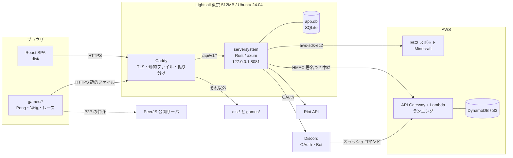

# 10. リニューアル全体設計

ロリポップ（Apache + PHP）から VPS に移し、API を Rust で作り直すための全体設計。
現状の調査は README〜05 にある。この文書はそれをもとに **「どう作るか」を決めたもの**。

この設計書は 4 つのファイルに分けてある。

| ファイル | 中身 |
|---|---|
| **10_architecture.md**（これ） | 決めたことの一覧、全体の形、方針、API と URL、セッション、Rust の構成、セキュリティ、まだ決まっていないこと、実装プランの分け方 |
| [11_vps_operations.md](11_vps_operations.md) | VPS の構成、リバースプロキシ、TLS、シークレット、バックアップ、デプロイ、CI |
| [12_migration_plan.md](12_migration_plan.md) | 移行の段階、切り替え方と戻し方、データ移行、計算結果を変えないためのテスト |
| [13_tasks.md](13_tasks.md) | タスク表、担当エージェント（モデル）の割り当て、ウェーブ、各タスクに渡すプロンプト |

前提（ユーザーが決めたこと）:

- リポジトリは今のまま使う。Rust の API は `server/` に作る。PHP（`api/`）は置き換えが終わったら消す。
- React SPA（`frontend/`）とブラウザゲーム（`games/`）は作り直さない。
- 移行は、リバースプロキシでパスごとに PHP と Rust に振り分けて、少しずつ切り替える。長く残す別ブランチは作らない。
- 機能を残すか捨てるかは `02_features.md` の判断欄のとおり（下の「[残る機能](#scope)」）。
- 身内向けの小さなサイトなので、運用の手間が少ないことを一番大事にする。

---

## 決めたことの一覧

| # | 決めたこと | 理由 |
|---|---|---|
| D1 | ランニング記録は **AWS に残す**。Rust 側は今の PHP と同じ HMAC 署名つきの中継だけを作る | [→](#d1) |
| D2 | ゲームサーバー起動は残すが、**Minecraft だけ**にする（Palworld・7 Days to Die はやめる）。**ログイン必須**にし、停止する相手はサーバー側でタグから探す（クライアントが送るインスタンス ID は使わない） | [→](#d2) |
| D3 | ログインは **Discord だけ**。OTP は作らない。**身内の Discord サーバー（ギルド）のメンバーだけ**がログインできる。ログインした人は全員、ゲームサーバーを起動・停止できる | [→](#d3) |
| D4 | サイト合言葉は残す。**API でも効かせる**。デバイストークンは localStorage をやめて HttpOnly Cookie にする | [→](#d4) |
| D5 | DB は **SQLite 1 ファイル**（`app.db`）。新しい DB に入れるのは Discord で紐付いたユーザーだけ。捨てる機能の DB は取り込まず、保管もしない | [→](#d5) |
| D6 | API の URL は **`/api/v1/...` に揃える**。JSON の形は今のまま変えず、変えるのは URL だけ（例外は 3 か所） | [→](#d6) |
| D7 | セッションは **サーバー側に持つ Cookie セッション**（SQLite に保存、自前で約 150 行）。JWT は使わない | [→](#d7) |
| D8 | CSRF 対策は **SameSite=Lax の Cookie と Origin ヘッダの確認**の 2 つ | [→](#d8) |
| D9 | Rust は **axum + tokio + sqlx（SQLite）+ reqwest + aws-sdk**。エラーは thiserror、設定は環境変数 | [→](#d9) |
| D10 | `server/` は **1 つのクレート・1 つのバイナリ**。サブコマンドで `serve` / `import-legacy` / `hash-password` | [→](#d10) |
| D11 | ロリポップの制約のための工夫は、捨てる機能と一緒に消えるものが多い。サーバー状態のポーリングと PeerJS の P2P は**そのまま残す** | [→](#d11) |
| D12 | VPS は **AWS Lightsail（東京・512 MB・IPv4 付き）の Ubuntu 24.04 + Caddy + systemd**。TLS は Caddy の自動取得 | [11 →](11_vps_operations.md#vps) |
| D13 | デプロイは **GitHub Actions でビルド → rsync over SSH → シンボリックリンクの切り替え**。戻すときはリンクを前のリリースに向け直す | [11 →](11_vps_operations.md#deploy) |
| D14 | バックアップは **Lightsail の自動スナップショット**（毎日・7 世代）。各段階の切り替えの前には手動でもスナップショットを撮る | [11 →](11_vps_operations.md#backup) |
| D15 | シークレットは **`/etc/serversystem/env`（root だけが読める）** に置き、systemd の EnvironmentFile で渡す | [11 →](11_vps_operations.md#secrets) |
| D16 | 移行は 5 段階。①ロリポップで穴を塞ぎ捨てる機能を消す → ②VPS に PHP のまま移す → ③Rust の土台と LoL 戦績 → ④認証・サーバー起動・ランニングをまとめて切り替え → ⑤PHP を消す | [12 →](12_migration_plan.md#stages) |
| D17 | ④の認証まわりは、**実装は機能ごとに分けるが、切り替えは 1 回で行う**（PHP と Rust でセッションを共有できないため） | [12 →](12_migration_plan.md#why-bundle) |
| D18 | Arena の Elo・LoL/VAL のポイント・TOTP は、機能を捨てるので **計算もデータも引き継がず、保管もしない** | [12 →](12_migration_plan.md#legacy) |
| D19 | 移す計算（ランニングの HMAC 署名・LoL の連勝計算・合言葉の bcrypt 照合）は、**固定の入出力（ゴールデンテスト）と本番での PHP との突き合わせ**で同じ結果になることを確かめる | [12 →](12_migration_plan.md#golden) |
| D20 | 05 に書かれたセキュリティの穴 7 件と、今回の調査で見つけた 5 件を、新しい設計で塞ぐ | [→](#security) |
| D21 | **新しいドメインを取る**。今の `valol.jellybean.jp`（ロリポップの共有ドメイン）からサイトの URL が変わる。段階 1 で新しい URL に移り、ロリポップからは新しい URL へ転送する | [12 →](12_migration_plan.md#stage1) |
| D22 | 実装は**難しさに合わせてモデルの違う 3 つのエージェント**（Haiku / Sonnet / Opus）に任せる。つなぎ目・ユーザーとの共同作業・確認とコミットはメインが受け持つ | [13 →](13_tasks.md) |

---

<a id="scope"></a>
## 1. 残る機能

`02_features.md` の判断欄のとおり。

| 残す | 捨てる |
|---|---|
| サイト合言葉（SiteGate） | OTP ログイン・新規登録（→ D3） |
| Discord ログイン | LoL チャンピオン情報・AI 質問 |
| プロフィール（アカウント削除） | LoL 試合予想・VALORANT 試合予想 |
| ゲームサーバー起動／停止（**Minecraft だけ**。穴は直す） | バンピック & ランキング（Arena） |
| ミニゲーム：Pong・軍儀・アイテムレース（`games/race`） | ミニゲーム：Auto Battle RPG（`games/minigame`）・ライン通過ゲーム（`games/linegame`） |
| 情報リンク | API 疎通確認（デバッグ） |
| LoL 戦績（連勝・ランク） | ゲームサーバーの Palworld・7 Days to Die |
| ランニング記録（Web・Discord Bot） | |

捨てる機能のコードは、移行の最初（段階 0）に PHP とフロントから消す。
移す量が減り、PHP のまま動く穴（VALORANT の結果確定、Arena の管理者乗っ取り）も一緒になくなるため。

その結果、Rust で作る API はこれだけになる（PHP 約 5,700 行のうち、残るのは 1,000 行弱）。

- サイト合言葉
- Discord ログイン・ログイン状態・ログアウト・アカウント削除
- ゲームサーバーの状態・起動・停止
- LoL 戦績
- ランニングの中継

---

## 2. 全体の形

### 移行が終わったあと



### 移行の途中（段階 1〜4）

Caddy が URL の先頭で振り分ける。`/api/v1/*` は Rust、それ以外の `/api/*` は PHP-FPM。
新しい URL と古い URL が重ならないので、**どの機能をどちらで動かすかは、フロントがどの URL を呼ぶかだけで決まる**。
切り替えも戻しもフロントのリリースを入れ替えるだけで済む（[12 の段階表](12_migration_plan.md#stages)）。

```
ブラウザ ──HTTPS──▶ Caddy
                     ├─ /api/v1/*          ──▶ Rust (127.0.0.1:8081)
                     ├─ /api/*             ──▶ PHP-FPM（移行が終わったら消す）
                     ├─ /games/*           ──▶ 静的ファイル
                     └─ それ以外           ──▶ dist/（なければ dist/index.html）
```

---

## 3. 方針の決定

<a id="d1"></a>
### D1. ランニング記録は AWS に残す

**決定**: Lambda・DynamoDB・S3・Discord Bot はそのまま。Rust は、PHP の `api/running/` と同じ「ログイン確認 → Discord ID を引く → HMAC 署名 → 転送」だけを作る。

**理由**
- 一番作り込まれていて、テストもあり、ちゃんと動いている。書き直すと TypeScript 約 3,500 行と Discord Bot（署名検証・ロール付与・月次バッチ）を Rust で作り直すことになり、作業がリニューアル全体の半分を超える。
- Discord の Interactions を受けるには、常に動いていて HTTPS で待ち受ける口が要る。今は API Gateway がその役をしているので、VPS が止まっても Bot は動き続ける。
- 費用はほぼかからない（サーバーレスで、使った分だけ）。
- 中継は約 100 行で、仕様（`document/running_api.md` §2）が決まっている。

**あとで VPS に持ってくるとき**: Rust 側の `/api/v1/running/*` の URL と JSON の形を変えなければ、フロントを直さずに中身だけ差し替えられる。そのため、中継は `services/running_relay.rs` に閉じ込めておく。

<a id="d2"></a>
### D2. ゲームサーバー起動はログイン必須にする

**決定**
- 状態の取得・起動・停止のすべてで、ログイン（D3 によりギルドのメンバー）を必須にする。状態にはサーバーの IP が含まれるため、取得も必須にする。
- 停止のときは、クライアントが送ってくる `instanceId` を使わない。サーバー側で `Name` タグから対象のインスタンスを探して、それを終了する。今の PHP は送られてきた ID をそのまま terminate しているため、**同じ AWS アカウントの別のインスタンスでも消せてしまう**（今回見つけた穴 N1）。
- AWS の権限は、専用の IAM ユーザーに最小限だけ渡す（[11 の IAM](11_vps_operations.md#iam)）。

**Minecraft だけにする**: Palworld と 7 Days to Die はユーザーの判断でやめる。段階 0 で PHP からも外す（T01）。AWS 側の起動テンプレートなどは、ユーザーが消す（T03）。URL は `/servers/{target}` の形のまま残し、`target` は `minecraft` だけを受け付ける（ほかは 404）。あとでゲームを足すときに、URL もフロントも変えずに済むようにするため。

**理由**: 起動すると課金が発生する。合言葉は全員が知っているので、合言葉だけでは足りない。かといって許可リストを作ると管理画面が要る。身内のギルドに入っていることを条件にすれば、設定は Guild ID 1 つで済む。

<a id="d3"></a>
### D3. ログインは Discord だけ、ギルドのメンバーに限る

**決定**
- OTP ログイン・新規登録は作らない。`otp_secret` は新しい DB に入れない。
- Discord OAuth2 の scope を `identify` から **`identify guilds.members.read`** に変える。コールバックで `GET /users/@me/guilds/{DISCORD_GUILD_ID}/member` を呼び、404 ならログインさせない（`/login?discord_error=not_member` に戻す）。
- メンバーかどうかは**ログインしたときだけ**確かめる。ギルドを抜けた人も、セッションが切れるまで（最大 30 日、D7）は使える。気になるならセッションの期間を短くする。
- ログインした人は全員、ゲームサーバーを起動・停止できる。管理者という区別は持たない。

**理由**
- 残す機能のうち、ユーザー ID を記録しているものは無い（ゲームサーバーも LoL 戦績も記録しない。ランニングは Discord ID で記録している）。OTP だけで登録した人が持っているデータは、捨てる機能（Arena・予想）の分しか無い。だから OTP をやめても、その人は次から Discord でログインし直せば何も失わない。
- これで TOTP の自前実装、QR を外部サービスで作っている穴（05 の #3）、平文の `otp_secret` がまとめて消える。
- `guilds.members.read` を使うと、1 回の呼び出しで、その人がギルドにいるかどうかだけを確かめられる。`guilds` で入っている全ギルドを取る方法より、受け取る情報が少なくて済む。Bot Token を VPS に置く必要もない。
- scope が変わるので、移行後の初回だけ Discord の同意画面が出る（`prompt=none` でも出る）。

<a id="d4"></a>
### D4. サイト合言葉は API でも効かせる

**決定**
- 合言葉を通ると、サーバーは `site_pass` Cookie（HttpOnly・Secure・SameSite=Lax、値は 32 バイトの乱数）を発行する。DB には値の SHA-256 だけを保存する。最後に使ってから 30 日で切れる（今と同じ）。
- **`/api/v1/*` のすべてのリクエストで `site_pass` を確かめる**（ミドルウェア）。例外は `GET /api/v1/site/status`・`POST /api/v1/site/login`・`GET /api/v1/health` の 3 つだけ。
- localStorage のデバイストークンと `site_device_login.php` はやめる。Cookie が同じ役をするので要らない。フロントの `SiteGate.jsx` は、状態を聞いて、通っていなければ入力欄を出すだけになる。古い localStorage のキーは起動時に消す。
- 合言葉のハッシュは今の bcrypt（`$2y$`）をそのまま使える（Rust の `bcrypt` クレートで照合でき、テストで確かめる。[12](12_migration_plan.md#golden)）。作り直すときは `serversystem hash-password` を使う（`generate_hash.php` の代わり）。
- 合言葉の総当たりを防ぐため、**IP ごとに 10 分で 10 回まで**失敗できるようにする（超えたら 429）。
- `/games/*`（静的ファイル）は今と同じく合言葉なしで開ける。サーバー側の処理もデータも無いため（変えるかどうかは「[まだ決まっていないこと](#undecided)」）。

**理由**: 今の合言葉は画面を隠しているだけで、API は直接叩ける（05 の #2）。Cookie にすると JavaScript から値が読めなくなり、合言葉の状態とログインの状態を同じ仕組みで扱える。

<a id="d5"></a>
### D5. DB は SQLite 1 ファイル

**決定**
- `/var/lib/serversystem/app.db` の 1 ファイルにする。テーブルは `users`・`sessions`・`site_passes` の 3 つだけ（[§6.4 のスキーマ](#schema)）。
- 移行のとき、旧 `auth.db` から **Discord と紐付いているユーザーだけ**を取り込む（`serversystem import-legacy`）。`users.id` は旧 DB の値を引き継ぐ。OTP だけのユーザーと `site_tokens`、`bot_requests` は取り込まない。
- 捨てる機能の DB（`arena.db`・`lol_predict.db`・`valorant_predict.db`）は取り込まず、保管もしない（ユーザーの判断。使わないため）。ロリポップを解約するときに一緒に消える。

**理由**
- 残るデータはユーザー表くらいしか無い。PostgreSQL にしても利点がなく、DB サーバーの更新・監視・バックアップの手間だけが増える。
- SQLite なら、Lightsail のディスクのスナップショットに DB も一緒に入る（WAL モードなので、スナップショットの瞬間の状態からそのまま復旧できる）。手元に落として `sqlite3` で中身を見ることもできる。
- 1 ファイルにまとめると外部キーが効くので、アカウントを消したときにセッションも一緒に消える（今は DB が分かれていて、他の DB に行が残る）。

<a id="d6"></a>
### D6. API の URL は `/api/v1/...` に揃える

**決定**
- 新しい API はすべて `/api/v1/` の下に置く。`.php` の URL は互換のために残さない。
- **JSON の形は今のまま変えない**。フロントで変えるのは基本的に URL だけにする。形を変えるのは次の 3 か所だけ。
  1. サイト合言葉：デバイストークンをやめる（D4）。
  2. ゲームサーバー：起動・停止を `POST /api/v1/servers/{target}/start|stop` にする（ボディの `action`・`instanceId` をやめる）。
  3. ログイン：OTP の入力欄と `/register` を消す。
- 成功・失敗の形は、今と同じ `{ "success": bool, "message": "日本語", ... }` を基本にする。ただし今その形で返していない 2 つ（LoL 戦績は配列そのもの、ログイン状態は `{loggedIn, userId, username}`）は、今の形のまま返す。

**理由**
- `.php` を残すと、Caddy の振り分けで PHP と Rust の URL が重なる。どちらが応えているのか分かりにくくなり、戻すときに間違えやすい。URL を分けておけば、**フロントのリリースを入れ替えるだけで切り替えも戻しもできる**。
- 呼び出し元はこのリポジトリのフロントだけ。外から API を直接叩いているもの（Bot など）は無い（ランニングの Bot は AWS を直接使う）ので、互換を残す理由がない。
- JSON の形を変えなければ、フロントの変更は少なく、PHP と Rust の応答を比べて確かめられる（[12](12_migration_plan.md#golden)）。

#### URL 対応表（旧 → 新）

| 機能 | 旧（PHP） | 新（Rust） | 認証 | 備考 |
|---|---|---|---|---|
| 合言葉の状態 | `GET /api/auth/site_status.php` | `GET /api/v1/site/status` | なし | 応答 `{authenticated}` は同じ |
| 合言葉の入力 | `POST /api/auth/site_login.php` | `POST /api/v1/site/login` | なし | `deviceToken` を返さず Cookie を出す。IP ごとの回数制限あり |
| デバイストークンで通過 | `POST /api/auth/site_device_login.php` | **廃止** | — | Cookie に統合 |
| ログイン状態 | `GET /api/auth/status.php` | `GET /api/v1/auth/status` | 合言葉 | 応答 `{loggedIn, userId, username}` は同じ。`reason:'timeout'` は返さない |
| OTP 新規登録 | `POST /api/auth/register.php` | **廃止** | — | D3 |
| OTP ログイン | `POST /api/auth/login.php` | **廃止** | — | D3 |
| ログアウト | `GET/POST /api/auth/logout.php` | `POST /api/v1/auth/logout` | 合言葉 | GET はやめる（CSRF） |
| アカウント削除 | `DELETE /api/auth/profile.php` | `DELETE /api/v1/me` | ログイン | |
| Discord 認可へ | `GET /api/auth/discord_redirect.php` | `GET /api/v1/auth/discord/start` | 合言葉 | |
| Discord コールバック | `GET /api/auth/discord_callback.php` | `GET /api/v1/auth/discord/callback` | 合言葉 | Discord の開発者画面に新しい URL を追加する（古い URL は段階 4 まで残す） |
| サーバー状態 | `GET /api/server/status.php` | `GET /api/v1/servers` | ログイン | 応答の形は同じ。`displayState` の `pending` の扱いを直す（§6.6） |
| サーバー起動 | `POST /api/server/control.php` `{action:start,target}` | `POST /api/v1/servers/{target}/start` | ログイン | `target` は `minecraft` だけ（ほかは 404） |
| サーバー停止 | `POST /api/server/control.php` `{action:stop,target,instanceId}` | `POST /api/v1/servers/{target}/stop` | ログイン | `instanceId` は受け取らない（D2） |
| LoL 戦績 | `GET /api/lol/streak.php` | `GET /api/v1/lol/streak` | 合言葉 | 応答（配列）は同じ |
| ランニング | `/api/running/index.php?path=/v1/<X>` | `/api/v1/running/<X>` | ログイン | `<X>` は今のホワイトリストと同じ 9 つ。中身はそのまま中継 |
| 死活確認 | — | `GET /api/v1/health` | なし | 新規。`{"success":true}` を返すだけ。デプロイの確認に使う |
| Arena | `/api/arena/...` | **廃止** | — | 段階 0 で消す |
| LoL 予想・AI | `/api/lol/predict.php` `champion-bot.php` | **廃止** | — | 段階 0 で消す |
| VALORANT 予想 | `/api/valorant/predict.php` | **廃止** | — | 段階 0 で消す |
| 疎通確認 | `/api/debug/api_check.php` | **廃止** | — | 段階 0 で消す |

「合言葉」は「`site_pass` Cookie が有効」という意味。「ログイン」はそれに加えてログインセッションが有効なこと。

ランニングで中継するパス（`<X>`）:
`GET/POST records`、`PATCH/DELETE records/{YYYY-MM-DD}_{32hex}`、`POST records/{id}/photo-url`、`POST records/{id}/photo`、`GET ranking`、`GET me/summary`、`GET settings`。
Rust は先頭の `/api/v1/running` を `/v1` に置き換えて AWS に送る（例：`/api/v1/running/records` → `/v1/records`）。

#### フロントの変更範囲

| ファイル | 変更 | 段階 |
|---|---|---|
| `pages/Arena*.jsx`・`components/arena/`・`hooks/useSeriesSync.js`・`lib/arenaApi.js`・`pages/LoLInfo.jsx`・`pages/LoLPredict.jsx`・`pages/ValorantPredict.jsx` | 削除 | 0 |
| `App.jsx`・`components/Sidebar.jsx` | 捨てる機能のルートとメニューを消す | 0 |
| `pages/MiniGames.jsx` | Auto Battle RPG とライン通過ゲームを一覧から消す（`games/minigame`・`games/linegame` も削除） | 0 |
| `pages/LoLStreak.jsx` | URL を `/api/v1/lol/streak` に | 2 |
| `components/SiteGate.jsx` | 作り直す（状態を確認 → 入力 → Cookie。localStorage を使わない） | 3 |
| `App.jsx` | ログイン状態の URL。`/server` を `RequireLogin` で包む。`/register` を消す | 3 |
| `pages/Login.jsx` | OTP の入力欄を消し、Discord ボタンだけにする。リンク先を `/api/v1/auth/discord/start` に。`not_member` のエラー表示を足す | 3 |
| `pages/Register.jsx` | 削除 | 3 |
| `pages/Profile.jsx`・`components/Sidebar.jsx` | URL の変更 | 3 |
| `pages/ServerControl.jsx` | URL と起動・停止の呼び方を変える。401 ならログイン画面へ | 3 |
| `lib/runningApi.js` | ベースを `/api/v1/running` にし、`?path=` のフォールバックを消す | 3 |
| `vite.config.js` | 開発用プロキシ：`/api/v1` → Rust（`localhost:8081`）、`/api` → PHP（`localhost:8080`）。段階 4 で PHP の行を消す | 2・4 |

---

<a id="d7"></a>
## 4. セッション

**決定**: サーバー側に持つ Cookie セッション。SQLite の `sessions` テーブルに保存し、自前で実装する。

| 項目 | 値 |
|---|---|
| Cookie 名 | `sid`（ログイン）、`site_pass`（合言葉）、`oauth_state`（Discord ログインの途中だけ） |
| Cookie の値 | 32 バイトの乱数を base64url にしたもの（推測できない） |
| DB に保存するもの | 値の **SHA-256**。DB が漏れても、そのままではセッションに使えない |
| 属性 | `HttpOnly; Secure; SameSite=Lax; Path=/`（`oauth_state` は `Path=/api/v1/auth/discord`・`Max-Age=600`） |
| ログインの有効期間 | 最後に使ってから **30 日**。`last_seen_at` の更新は 1 時間に 1 回まで（書き込みを減らすため） |
| 合言葉の有効期間 | 最後に使ってから 30 日（今と同じ） |
| 期限切れの掃除 | `serve` の中で 1 時間ごとに、期限切れの行を消す（tokio のタイマー） |
| ログアウト | その行を消し、Cookie を空にして返す |
| アカウント削除 | `users` を消す。外部キーの `ON DELETE CASCADE` でセッションも消える |

**理由**
- **JWT にしない理由**: 取り消し（ログアウト・アカウント削除）のために結局サーバー側に表が要る。それなら最初から表に持つほうが単純。署名鍵の管理も要らない。
- **tower-sessions などのライブラリを使わない理由**: やることは「乱数を作る・ハッシュを保存する・照合する・期限を延ばす」だけで、約 150 行で書ける。仕組みが手元に全部あるので、合言葉とログインで同じ書き方ができ、テストで時刻を固定しやすい。ライブラリの大きな更新に付き合う必要もない。
- **30 日にする理由**: 今は 30 分で切れるが、Discord ログインは `prompt=none` でボタン 1 回なので、長めにして手間を減らす。危ない操作（ゲームサーバーの起動）はギルドのメンバーに限っている。短くしたいときは定数 1 つで変えられる。
- PHP のセッションは引き継げないので、切り替えのとき（段階 3）に全員が合言葉とログインを 1 回やり直す。

Discord ログインの流れ:

```
1. GET /api/v1/auth/discord/start
     state = 乱数 → oauth_state Cookie に入れる → Discord の認可画面へ 302
2. Discord → GET /api/v1/auth/discord/callback?code&state
     state を Cookie と照合（定数時間比較）→ Cookie を消す
     code → アクセストークン（POST /oauth2/token）
     GET /users/@me                         → id, global_name / username
     GET /users/@me/guilds/{GUILD}/member   → 404 なら not_member
     users を discord_id で upsert（表示名を更新、last_login_at を記録）
     sessions に 1 行作る → sid Cookie → /server へ 302
```

エラーのときは今と同じく `/login?discord_error=<理由>` へ戻す（`invalid_state` / `denied` / `token_exchange_failed` / `user_fetch_failed` / `not_member` / `db_error`）。

<a id="d8"></a>
## 5. CSRF 対策

**決定**: 次の 2 つを両方入れる。

1. すべての Cookie を `SameSite=Lax` にする。ほかのサイトから送られる POST / DELETE などには、Cookie が付かない。
2. **Origin の確認**（ミドルウェア）。`GET`・`HEAD`・`OPTIONS` 以外のリクエストでは、`Origin` ヘッダが設定値 `APP_PUBLIC_ORIGIN`（例 `https://example.com`）と完全に一致しなければ 403 を返す。`Origin` が無いときは `Referer` の先頭を見る。どちらも無ければ 403 にする。

CORS のヘッダは一切返さない（同じオリジンからしか使わないため）。

**理由**: どちらか 1 つでも、今のブラウザならほぼ防げる。両方入れておけば、どちらかの設定を間違えても穴にならない。フロントの `fetch` は同じオリジンへの POST / DELETE で `Origin` を自動で付けるので、フロントを直す必要はない。CSRF トークンを使う方式は、フロントにトークンの受け渡しを足す必要があるので採らない。
Discord のコールバックは GET なので Origin の確認の対象外で、そのかわり `state` で守る。

---

<a id="d9"></a>
## 6. Rust の構成

### 6.1 技術選定

メジャーバージョンは書いた時点のもの。実装するときの最新の安定版を使い、`Cargo.lock` をコミットする。ツールチェーンは `rust-toolchain.toml` で固定する（edition 2024）。

| 用途 | 使うもの | 理由 |
|---|---|---|
| 非同期ランタイム | `tokio` 1 | 事実上の標準。axum・reqwest・aws-sdk・sqlx がすべてこれを前提にしている |
| Web フレームワーク | `axum` 0.8 + `tower-http` 0.6（trace, timeout, limit） | tokio と同じ開発元で、ミドルウェアを tower で組める。情報が多く、サブエージェントが迷いにくい |
| Cookie | `axum-extra`（`cookie` 機能） | axum 用の公式の補助クレート |
| DB | `sqlx` 0.8（`sqlite`, `runtime-tokio`, `migrate`） | 非同期で使え、マイグレーションをバイナリに埋め込める（`sqlx::migrate!`）。**クエリは実行時に確かめる書き方（`sqlx::query_as::<_, T>()`）にし、コンパイル時に確かめるマクロ（`query!`）は使わない**。マクロを使うとビルドに DB か `.sqlx` ファイルが要り、CI とサブエージェントの手順が増えるため |
| HTTP クライアント | `reqwest` 0.12（`rustls-tls`, `json`、`default-features = false`） | Discord・Riot・ランニングの AWS を呼ぶ。rustls にして OpenSSL に頼らない（ビルドと配布が楽） |
| AWS | `aws-config` + `aws-sdk-ec2` | 公式。認証情報は標準の環境変数（`AWS_ACCESS_KEY_ID` など）から自動で読む |
| trait の非同期関数 | `async-trait` | `GameServerBackend` を `Arc<dyn ...>` で差し替えるため（標準の async fn in trait は dyn にできない） |
| 暗号 | `hmac` + `sha2` + `hex`、`rand`、`bcrypt`、`subtle`（定数時間比較） | RustCrypto の定番 |
| JSON | `serde` + `serde_json` | |
| エラー | `thiserror` 2（API 側）、`anyhow`（`main` と CLI だけ） | API はエラーの種類ごとにステータスを決めたいので型を作る。CLI は原因を表示できればよい |
| ログ | `tracing` + `tracing-subscriber`（標準出力 → journald） | systemd が journald に集めるので、ファイルを扱う必要がない |
| CLI | `clap` 4（derive） | サブコマンドを作る |
| 設定 | 環境変数を手書きで読む（`config.rs`）＋ 開発時だけ `dotenvy` で `.env` を読む | 項目が 20 個ほどで、設定を重ねる仕組みは要らない。足りない項目を全部まとめてエラーにする |
| テスト | 標準の `#[tokio::test]`、`tower::ServiceExt::oneshot`、`wiremock`（外部 HTTP の代わり）、`tempfile` | 外部 API は、ベース URL を設定で差し替えて wiremock に向ける |

使わないもの:
- ORM（Diesel / SeaORM）：テーブルが 3 つなので、素の SQL のほうが読みやすい。
- Docker：バイナリ 1 つを systemd で動かすほうが手間が少ない（[11](11_vps_operations.md#vps)）。
- Redis などのキャッシュサーバー：プロセスが 1 つなので、メモリ上のキャッシュで足りる。

<a id="d10"></a>
### 6.2 モジュール構成

```
server/
├─ Cargo.toml / Cargo.lock / rust-toolchain.toml
├─ .env.example              # 開発用の設定の見本（値はダミー）
├─ migrations/
│  └─ 0001_init.sql          # §6.4 のスキーマ
├─ src/
│  ├─ main.rs                # clap でサブコマンドを分けるだけ
│  ├─ lib.rs                 # build_app(state) -> Router を公開（結合テストから使う）
│  ├─ config.rs              # Config::from_env()。足りない項目を全部並べてエラーにする
│  ├─ error.rs               # AppError（thiserror）と IntoResponse
│  ├─ state.rs               # AppState: Config, SqlitePool, reqwest::Client, Clock, 各サービス
│  ├─ clock.rs               # trait Clock { fn now(&self) -> i64 }（UNIX 秒）。テストでは時刻を固定する
│  ├─ db.rs                  # 接続（PRAGMA の設定）とマイグレーションの実行
│  ├─ middleware/
│  │  ├─ site_gate.rs        # site_pass がなければ 401（例外の 3 パスを除く）
│  │  ├─ csrf.rs             # Origin の確認
│  │  └─ rate_limit.rs       # 合言葉の失敗回数（IP ごと、メモリ上）
│  ├─ auth/
│  │  ├─ token.rs            # 乱数トークンの生成と SHA-256（sid と site_pass で共用）
│  │  ├─ session.rs          # ログインセッションの発行・確認・延長・削除。CurrentUser 抽出子
│  │  ├─ site_pass.rs        # 合言葉 Cookie の発行・確認・延長
│  │  └─ discord.rs          # OAuth（トークン交換・@me・ギルドのメンバー確認）
│  ├─ routes/
│  │  ├─ mod.rs              # ルータの組み立て（どのパスにどのミドルウェアがかかるかはここで全部わかるようにする）
│  │  ├─ health.rs
│  │  ├─ site.rs             # /site/status, /site/login
│  │  ├─ auth.rs             # /auth/status, /auth/logout, /auth/discord/*
│  │  ├─ me.rs               # DELETE /me
│  │  ├─ servers.rs          # /servers, /servers/{target}/start|stop
│  │  ├─ lol.rs              # /lol/streak
│  │  └─ running.rs          # /running/*（ホワイトリスト → services::running_relay）
│  ├─ services/
│  │  ├─ game_servers.rs     # trait GameServerBackend と Ec2Backend。displayState の判定、起動中ロック、状態の 3 秒キャッシュ
│  │  ├─ lol_streak.rs       # Riot API の呼び出しと、連勝計算の純粋関数（別にしてテストする）。5 分キャッシュ
│  │  └─ running_relay.rs    # canonical string の作成・署名・転送
│  └─ cli/
│     ├─ import_legacy.rs    # 旧 auth.db から users を取り込む（--dry-run あり）
│     └─ hash_password.rs    # 合言葉の bcrypt ハッシュを作る
└─ tests/
   ├─ common/mod.rs          # テスト用の AppState（一時 DB、固定の時刻、wiremock）
   ├─ site_gate.rs / auth.rs / servers.rs / lol.rs / running.rs
   └─ fixtures/              # ゴールデンテストの入出力（12 を参照）
```

約束ごと（実装するときに守ること）:
- `routes/` は「入力を受け取る → サービスを呼ぶ → JSON を返す」だけにする。判断や計算は `services/` か `auth/` に書く。
- 外に出る呼び出し（Discord・Riot・ランニングの AWS・EC2）は、**ベース URL を設定で差し替えられるようにするか、trait の後ろに隠す**。テストで本物を呼ばないため。EC2 は `GameServerBackend` という trait にする（aws-sdk はモックしにくいため）。
- 時刻は必ず `state.clock.now()` から取る。`SystemTime::now()` を直接呼ばない（期限切れのテストのため）。
- 日時は DB でも API でも **UNIX 秒の整数**（今と同じ）。
- ログにシークレットや Cookie の値を出さない。`Config` の `Debug` ではシークレットを伏せる。

### 6.3 エラー処理

```rust
#[derive(thiserror::Error, Debug)]
pub enum AppError {
    #[error("{0}")]            BadRequest(String),   // 400
    #[error("サイト認証が必要です")] SiteAuthRequired,      // 401
    #[error("認証が必要です")]     LoginRequired,         // 401
    #[error("{0}")]            Forbidden(String),    // 403
    #[error("見つかりません")]     NotFound,              // 404
    #[error("{0}")]            Conflict(String),     // 409（例：起動処理中）
    #[error("しばらく待ってからお試しください")] TooManyRequests, // 429
    #[error("外部サービスに接続できませんでした")] Upstream(#[source] anyhow::Error), // 502 / 503
    #[error("サーバーエラーが発生しました")] Internal(#[source] anyhow::Error),   // 500
}
```

- 応答はすべて `{"success": false, "message": "<日本語>"}` とステータスコード。`message` はそのまま画面に出るので、日本語で、内部の事情を書かない。
- `Internal` と `Upstream` は、元のエラーを `tracing::error!` でログに出し、利用者には決まった文言だけを返す（今の PHP は AWS のエラー文をそのまま画面に出しているので、それもやめる）。
- `sqlx::Error` などからは `From` で `Internal` に変える。

<a id="schema"></a>
### 6.4 DB スキーマ（`migrations/0001_init.sql`）

```sql
-- ユーザー（Discord ログインだけなので discord_users と 1 つにした）
CREATE TABLE users (
  id            INTEGER PRIMARY KEY,          -- 旧 auth.db の users.id を引き継ぐ
  discord_id    TEXT    NOT NULL UNIQUE,
  display_name  TEXT    NOT NULL,             -- global_name、なければ username。ログインのたびに更新
  created_at    INTEGER NOT NULL,
  last_login_at INTEGER NOT NULL
);

CREATE TABLE sessions (
  token_hash   BLOB    PRIMARY KEY,           -- SHA-256(sid の値)
  user_id      INTEGER NOT NULL REFERENCES users(id) ON DELETE CASCADE,
  created_at   INTEGER NOT NULL,
  last_seen_at INTEGER NOT NULL
);
CREATE INDEX sessions_user ON sessions(user_id);

CREATE TABLE site_passes (
  token_hash   BLOB    PRIMARY KEY,           -- SHA-256(site_pass の値)
  device_name  TEXT    NOT NULL,              -- User-Agent から作る（今の deviceNameFromUA と同じ分け方）
  created_at   INTEGER NOT NULL,
  last_used_at INTEGER NOT NULL
);
```

- 期限は `last_seen_at` / `last_used_at` に 30 日を足して判定する（期限の列は持たない。期間を変えたときに、既存の行も新しい期間で判定されるようにするため）。
- 接続するたびに `PRAGMA foreign_keys=ON; journal_mode=WAL; busy_timeout=5000; synchronous=NORMAL;` を設定する。プールは最大 5 接続。
- マイグレーションは `serve` の起動時に `sqlx::migrate!` で流す。**列の削除や名前の変更は、それを使うコードの変更とは別のリリースにする**（前のリリースに戻したときに古いバイナリが動くように。[11 の戻し方](11_vps_operations.md#deploy)）。

### 6.5 設定（環境変数）

| 変数 | 例 | 用途 |
|---|---|---|
| `APP_LISTEN` | `127.0.0.1:8081` | 待ち受け。外には出さない（Caddy からだけ） |
| `APP_DATABASE_PATH` | `/var/lib/serversystem/app.db` | |
| `APP_PUBLIC_ORIGIN` | `https://example.com` | Origin の確認とリダイレクト先 |
| `APP_COOKIE_SECURE` | `true` | 開発時だけ `false` |
| `APP_SITE_GATE_ENABLED` | `true` | 合言葉のミドルウェアの ON/OFF。段階 2〜3 の途中までは `false`（[12](12_migration_plan.md#stage3)） |
| `SITE_PASSWORD_HASH` | `$2y$10$...` | 合言葉の bcrypt ハッシュ |
| `DISCORD_CLIENT_ID` / `DISCORD_CLIENT_SECRET` | | OAuth |
| `DISCORD_REDIRECT_URI` | `https://example.com/api/v1/auth/discord/callback` | |
| `DISCORD_GUILD_ID` | | メンバーかどうかを確かめるギルド |
| `AWS_ACCESS_KEY_ID` / `AWS_SECRET_ACCESS_KEY` / `AWS_REGION` | | EC2（aws-config が自動で読む） |
| `EC2_LT_MINECRAFT` | `lt-0123...` | Minecraft の起動テンプレート ID（版は `$Latest` で起動する） |
| `RIOT_API_KEY` | | LoL 戦績 |
| `LOL_MEMBERS` | `名前#JP1,名前2#TAG` | 戦績を出すメンバー（カンマ区切り、`#` の前が名前・後がタグ） |
| `RUNNING_API_BASE` | `https://xxxx.execute-api.ap-northeast-1.amazonaws.com` | ランニングの API Gateway |
| `RUNNING_SHARED_SECRET` | | HMAC の共有シークレット（SSM の `/running/proxy-shared-secret` と同じ値） |
| `RUNNING_TIMEOUT_SECS` | `10` | |
| `DISCORD_API_BASE` / `RIOT_ACCOUNT_BASE` / `RIOT_PLATFORM_BASE` | （省略時は本物の URL） | テストで wiremock に向けるため |

ゲームサーバーの名前・タグ・ポート（`⛏️ Minecraft` / `minecraft` / 25565）は秘密ではないので、`services/game_servers.rs` に定数の一覧として書く（今の PHP と同じ値）。一覧の形にしておくのは、あとでゲームを足すときに 1 行足せば済むようにするため。

<a id="gameservers"></a>
### 6.6 ゲームサーバーの判定（今の PHP からの変更点つき）

`displayState` の決め方:

| EC2 の状態 | `GameStatus` タグ | 起動中ロック | `displayState` |
|---|---|---|---|
| `shutting-down` / `stopping` | — | — | `closing` |
| `running` | `Online` | — | `ready` |
| `running` | それ以外 | — | `loading` |
| `pending` | — | — | `pending` ← **変更**（今の PHP では `stopped` と出てしまう） |
| 見つからない | — | 120 秒以内 | `pending` |
| 見つからない | — | なし | `stopped` |

- 起動中ロックは、ロックファイルをやめて**メモリ上**（`Mutex<HashMap<target, 時刻>>`）に持つ。プロセスは 1 つなので足りる。再起動すると消えるが、起動のときに必ず EC2 に問い合わせて重複を確かめるので困らない。「ロックを確かめる → EC2 を確かめる → 起動する」の間は、ターゲットごとの Mutex で 1 つずつしか通さない（同時に 2 回押しても 2 台立たない）。
- 状態の取得結果は **3 秒キャッシュ**する。複数の人が 5 秒ごとに見ても、AWS への問い合わせは増えない。起動・停止をしたらキャッシュを捨てる。
- 起動のパラメータ（スポット・one-time・中断時 terminate・`Name` と `GameStatus=Booting` のタグ）は今と同じにする。
- **Minecraft サーバー側との約束**（サーバーの起動構成を変えるときも守る。サーバー側の改修は、このリニューアルとは別に進めてよい）:
  - 起動テンプレートは ID を変えず、AMI などを変えるときは**同じテンプレートの新しい版**にする（サイトは `$Latest` で起動する）。
  - 準備ができたら、サーバー自身が `GameStatus=Online` のタグを付ける。
  - 無人になったら、サーバー自身が終了する（サイトは、インスタンスが消えたら「停止」と表示するだけ）。
  - 終了の途中で `GameStatus` を `Offline` などに戻さない（`running` の間に一瞬「読み込み中」と出てしまうため）。

---

<a id="seams"></a>
### 6.7 つなぎ目（モジュールどうしの約束）

ここに書いた型と関数の形は、**土台のタスク（T09）で先に全部作る**。中身は仮のもの（「未実装」の 501 を返す）にしておき、そのあとの各タスクは自分の担当ファイルの中身だけを埋める。
こうすると、並べて動かすタスクどうしが同じファイル（`state.rs`・`routes/mod.rs`・`Cargo.toml`）を触らずに済む。
**形を変えたくなったら、担当のエージェントは変えずに報告し、メインが決めてこの節を直してから変える。**

```rust
// ── clock.rs ───────────────────────────────────────────────
pub trait Clock: Send + Sync { fn now(&self) -> i64; }        // UNIX 秒
pub struct SystemClock;
pub struct FixedClock(pub std::sync::atomic::AtomicI64);     // テスト用。set(t) / advance(secs) を持つ

// ── error.rs ───────────────────────────────────────────────
pub enum AppError { /* §6.3 のとおり */ }
pub type AppResult<T> = Result<T, AppError>;

// ── config.rs ──────────────────────────────────────────────
pub struct Config { /* §6.5 の環境変数を 1 つずつフィールドにする */ }
impl Config {
    pub fn from_env() -> anyhow::Result<Config>;              // 足りない項目を全部並べてエラー
    pub fn for_test() -> Config;                               // テスト用の固定値（外部 URL は空）
}

// ── state.rs ───────────────────────────────────────────────
#[derive(Clone)]
pub struct AppState {
    pub config: Arc<Config>,
    pub db: sqlx::SqlitePool,
    pub http: reqwest::Client,                                 // タイムアウト 10 秒、User-Agent "serversystem"
    pub clock: Arc<dyn Clock>,
    pub site_login_limiter: Arc<RateLimiter>,                  // middleware/rate_limit.rs
    pub game_servers: Arc<GameServerService>,
    pub lol: Arc<LolStreakService>,
    pub running: Arc<RunningRelay>,
    pub discord: Arc<DiscordOAuth>,
}

// ── auth/token.rs ──────────────────────────────────────────
pub fn new_token() -> String;                                  // 32 バイトの乱数 → base64url（パディングなし）
pub fn hash_token(token: &str) -> Vec<u8>;                     // SHA-256（32 バイト）

// ── auth/session.rs ────────────────────────────────────────
pub const SESSION_COOKIE: &str = "sid";
pub const SESSION_TTL_SECS: i64 = 30 * 86_400;
pub const SESSION_TOUCH_INTERVAL_SECS: i64 = 3_600;
pub struct SessionUser { pub user_id: i64, pub discord_id: String, pub display_name: String }
pub async fn create_session(db: &SqlitePool, user_id: i64, now: i64) -> AppResult<String>;      // 生のトークンを返す
pub async fn find_session_user(db: &SqlitePool, token: &str, now: i64) -> AppResult<Option<SessionUser>>; // 期限切れは None。必要なら last_seen_at を更新
pub async fn delete_session(db: &SqlitePool, token: &str) -> AppResult<()>;
pub async fn purge_expired_sessions(db: &SqlitePool, now: i64) -> AppResult<u64>;
pub fn session_cookie(token: &str, config: &Config) -> Cookie<'static>;
pub fn clear_session_cookie(config: &Config) -> Cookie<'static>;
pub struct CurrentUser(pub SessionUser);         // FromRequestParts<AppState>。無ければ AppError::LoginRequired
pub struct MaybeUser(pub Option<SessionUser>);   // FromRequestParts<AppState>。失敗しない

// ── auth/site_pass.rs ──────────────────────────────────────
pub const SITE_PASS_COOKIE: &str = "site_pass";
pub const SITE_PASS_TTL_SECS: i64 = 30 * 86_400;
pub async fn create_site_pass(db: &SqlitePool, device_name: &str, now: i64) -> AppResult<String>;
pub async fn check_site_pass(db: &SqlitePool, token: &str, now: i64) -> AppResult<bool>;        // 有効なら last_used_at を更新
pub async fn purge_expired_site_passes(db: &SqlitePool, now: i64) -> AppResult<u64>;
pub fn site_pass_cookie(token: &str, config: &Config) -> Cookie<'static>;
pub fn device_name_from_ua(ua: &str) -> &'static str;           // 今の deviceNameFromUA と同じ分け方

// ── middleware ────────────────────────────────────────────
pub async fn require_site_pass(State(s): State<AppState>, req: Request, next: Next) -> Response; // site_gate.rs。APP_SITE_GATE_ENABLED=false なら素通り
pub async fn check_origin(State(s): State<AppState>, req: Request, next: Next) -> Response;      // csrf.rs
pub struct RateLimiter;                                         // rate_limit.rs
impl RateLimiter {
    pub fn new(max_failures: u32, window_secs: i64) -> Self;    // 本番は (10, 600)
    pub fn is_blocked(&self, ip: &str, now: i64) -> bool;
    pub fn record_failure(&self, ip: &str, now: i64);
}
pub fn client_ip(headers: &HeaderMap) -> String;                // X-Forwarded-For の一番右。無ければ "unknown"

// ── auth/discord.rs ────────────────────────────────────────
pub struct DiscordOAuth { /* client_id, secret, redirect_uri, guild_id, api_base, http */ }
pub struct DiscordMe { pub id: String, pub username: String, pub global_name: Option<String> }
impl DiscordOAuth {
    pub fn authorize_url(&self, state: &str) -> String;         // scope=identify guilds.members.read, prompt=none
    pub async fn exchange_code(&self, code: &str) -> anyhow::Result<String>;      // アクセストークン
    pub async fn fetch_me(&self, access_token: &str) -> anyhow::Result<DiscordMe>;
    pub async fn is_guild_member(&self, access_token: &str) -> anyhow::Result<bool>; // 404 → false
}

// ── services/game_servers.rs ──────────────────────────────
#[async_trait] pub trait GameServerBackend: Send + Sync {
    async fn find_instance(&self, name_tag: &str) -> anyhow::Result<Option<InstanceInfo>>; // 終了済みは除く
    async fn run_from_template(&self, launch_template_id: &str, name_tag: &str) -> anyhow::Result<()>;
    async fn terminate(&self, instance_id: &str) -> anyhow::Result<()>;
}
pub struct InstanceInfo { pub instance_id: String, pub state: String, pub public_ip: Option<String>, pub game_status: Option<String> }
pub struct GameServerService { /* backend, 起動テンプレート ID, ロック, キャッシュ */ }
impl GameServerService {
    pub fn new(backend: Arc<dyn GameServerBackend>, config: &Config) -> Self;
    pub async fn status(&self, now: i64) -> AppResult<serde_json::Value>;      // 今の status.php と同じ形
    pub async fn start(&self, target: &str, now: i64) -> AppResult<String>;    // 成功時の message
    pub async fn stop(&self, target: &str) -> AppResult<String>;
}

// ── services/lol_streak.rs ────────────────────────────────
pub struct LolStreakService { /* http, api_key, members, base URL, 5 分キャッシュ */ }
impl LolStreakService { pub async fn get(&self, now: i64) -> AppResult<serde_json::Value>; } // 今の streak.php と同じ配列

// ── services/running_relay.rs ─────────────────────────────
pub fn canonical(method: &str, path: &str, query: &str, discord_id: &str, ts: &str, nonce: &str, body: &[u8]) -> String;
pub fn sign(canonical: &str, secret: &str) -> String;           // 小文字 hex
pub struct RunningRelay { /* http, base, secret, timeout */ }
impl RunningRelay {
    pub async fn forward(&self, method: &str, upstream_path: &str, raw_query: &str,
                         discord_id: &str, body: Bytes, now: i64) -> AppResult<(StatusCode, Bytes)>;
}

// ── lib.rs ────────────────────────────────────────────────
pub fn build_app(state: AppState) -> axum::Router;              // ミドルウェアとルートを全部つないだもの
```

テストの補助（`tests/common/mod.rs`、T09 で作る）:

```rust
pub async fn test_state() -> (AppState, Arc<FixedClock>);       // メモリ上の SQLite、マイグレーション済み、時刻固定
pub async fn create_user(state: &AppState, discord_id: &str, name: &str) -> i64;
pub async fn login_cookie(state: &AppState, user_id: i64) -> String;      // "sid=..." を返す
pub async fn site_pass_cookie(state: &AppState) -> String;                 // "site_pass=..." を返す
pub fn json_request(method: &str, uri: &str, cookies: &[&str], body: Option<serde_json::Value>) -> Request<Body>; // Origin を自動で付ける
```

---

<a id="d11"></a>
## 7. ロリポップの制約のための工夫をどうするか

| 工夫 | どうするか | 理由 |
|---|---|---|
| Arena のドラフトの 1 秒ポーリング + 304 | **なくなる** | Arena を捨てる |
| ターン制限・48 時間自動承認の遅延評価 | **なくなる** | Arena を捨てる |
| 予想の同期を「一覧を開いた時」に実行 | **なくなる** | 予想を捨てる |
| Arena 管理者の自己登録 | **なくなる** | Arena を捨てる。新しい設計には管理者という概念自体が無い |
| ゲームサーバー状態の 5 秒ポーリング | **残す**（サーバー側に 3 秒キャッシュを足す） | 見ている人は数人で、サーバーは 1 台。EC2 の状態はどのみちサーバー側から AWS に聞きに行く必要があるので、WebSocket や SSE にしても AWS へのポーリングは無くならない。仕組みが増えるわりに得るものが少ない |
| 起動中のロックファイル（`starting_*.lock`） | **メモリ上のロックに変える** | 常駐プロセスなのでファイルが要らない |
| LoL 戦績の一時ファイルキャッシュ（5 分） | **メモリ上のキャッシュに変える**（5 分）。更新は同時に 1 つだけ | 同じ。Riot API の回数制限も守りやすい |
| 期限切れトークンを「使われた時に」掃除 | **1 時間ごとのタスクで掃除** | 常駐できるので |
| ゲームの PeerJS（公開サーバ）による P2P | **そのまま残す** | ゲームは作り直さない方針。P2P のままで動いているし、サーバーの負荷も無い。自前の仲介サーバーを立てるかは「[まだ決まっていないこと](#undecided)」 |
| 合言葉トークンを localStorage に保存 | **HttpOnly Cookie に変える**（D4） | JavaScript から読めない場所に置く |
| 設定ファイルを FTP で手置き | **`/etc/serversystem/env` に変える**（D15） | SSH が使える |
| FTP（lftp）でデプロイ | **rsync over SSH とシンボリックリンクの切り替えに変える**（D13） | 差分の転送、まとめての入れ替え、すぐ戻せること |
| `?path=` のルーティング | **なくなる** | axum のルータで普通に扱える |
| 機能ごとに別の SQLite | **1 ファイルにまとめる**（D5） | |
| ランニングを AWS に分ける | **残す**（D1） | |

---

<a id="security"></a>
## 8. セキュリティ上の穴の塞ぎ方

### 05 に書かれていた穴

| # | 穴 | 新しい設計での塞ぎ方 | いつ塞がるか |
|---|---|---|---|
| 1 | ゲームサーバーの起動・停止 API に認証が無い | ログイン（＝ギルドのメンバー）を必須にする（D2・D3）。**段階 0 で PHP にも応急処置を入れる** | 段階 0（PHP）→ 段階 3（Rust） |
| 2 | サイト合言葉が API で効いていない | すべての `/api/v1/*` に合言葉のミドルウェアをかける（D4） | 段階 3 |
| 3 | OTP シークレットを外部の QR サービスに渡している | OTP をやめる（D3）。登録画面ごと消す | 段階 3（それまでは新規登録を止めてもよい） |
| 4 | VALORANT の結果確定が誰でもできる | 機能ごと消す | 段階 0 |
| 5 | AWS の長期アクセスキーを PHP が持っている | Lightsail のインスタンスには EC2 のような IAM ロールを付けられない。かわりに**専用の IAM ユーザーに最小限の権限**（Minecraft の起動テンプレートからの起動と、`Name=minecraft` のタグが付いたインスタンスの終了だけ）を渡す。キーは root だけが読めるファイルに置く。古いキーは段階 4 で消す（[11 の IAM](11_vps_operations.md#iam)） | 段階 3（Rust 用のキー）・段階 4（古いキーを消す） |
| 6 | Arena の初代管理者を誰でも取れる | 機能ごと消す。管理者という概念を持たない | 段階 0 |
| 7 | 状態を変える API に CSRF 対策が無い | SameSite=Lax と Origin の確認（D8） | 段階 3 |

### 今回の調査で見つけた穴

| # | 穴 | 塞ぎ方 |
|---|---|---|
| N1 | ゲームサーバーの停止が、**クライアントの送った `instanceId` をそのまま terminate する**。同じ AWS アカウントの別のインスタンスでも消せる | サーバー側でタグから探したインスタンスだけを終了する（D2）。IAM でもタグで制限する。**段階 0 で PHP にも入れる** |
| N2 | 合言葉に回数制限が無い（総当たりできる） | IP ごとに 10 分で 10 回まで（D4） |
| N3 | デバイストークンやセッションを平文で保存している | DB には SHA-256 だけを保存する（D7） |
| N4 | Discord アカウントがあれば、誰でもログインできる | ギルドのメンバーに限る（D3） |
| N5 | エラー時に AWS や外部 API のエラー文をそのまま画面に返している | 決まった日本語の文言だけを返し、詳しい内容はログに出す（§6.3） |

### そのほか、新しく入れるもの

- Caddy で付けるセキュリティヘッダ：`Strict-Transport-Security`、`X-Content-Type-Options: nosniff`、`Referrer-Policy: strict-origin-when-cross-origin`、`X-Frame-Options: SAMEORIGIN`。CSP はゲームが unpkg から読み込んでいるので、今回は入れない（「まだ決まっていないこと」）。
- Rust は `127.0.0.1` でだけ待ち受け、外からは Caddy を通してしか届かないようにする。
- リクエストボディの上限は 16 KiB（ランニングの中継と同じ。写真は S3 に直接送るので大きなボディは来ない）。
- systemd でサンドボックスにする（`NoNewPrivileges`・`ProtectSystem=strict` など。[11](11_vps_operations.md#systemd)）。
- SSH は鍵だけにし、パスワードログインを止める。開けるポートは 22 / 80 / 443 だけ（[11](11_vps_operations.md#vps)）。

---

<a id="undecided"></a>
## 9. まだ決まっていないこと

| 項目 | 今の考え | 決める人・時期 |
|---|---|---|
| ドメイン名 | 新しく取る（D21）。一番手間が少ないのは、**Route 53 で取り、そのまま Route 53 のホストゾーンで A レコードを管理する**方法（AWS の中で完結し、Lightsail の静的 IP に向けるだけで済む）。ほかの業者で取り、DNS を Lightsail の DNS ゾーン（無料）に任せてもよい | ユーザー・段階 1 の前（T04） |
| `/games/*` にも合言葉をかけるか | 今はかけない（静的ファイルだけで、データも無い）。かけるなら Caddy の `forward_auth` で `/api/v1/site/status` を使えば、ゲーム側を直さずに済む | ユーザー（いつでも） |
| PeerJS の公開サーバーに頼り続けるか | 当面はこのまま。公開サーバーが不安定になったら、VPS に PeerServer（Node 製）を立てるか、Rust で同じ仲介を作るかを考える。512 MB の Lightsail に載せるなら Rust のほうが軽い | 必要になったとき |
| CSP（Content-Security-Policy） | ゲームが unpkg から読み込んでいるので、許可するリストを作ってからにする | あとで |
| 死活監視 | 最初は無し。必要なら Lightsail のメトリクスのアラーム（CPU・ステータスチェック）か、外部の無料の死活監視サービスで `/api/v1/health` を見る | あとで |
| セッションの期間（30 日） | ギルドを抜けた人を早く締め出したいなら短くする | ユーザー（いつでも、定数 1 つ） |
| ランニングを VPS に持ってくるか | 今回はしない（D1）。512 MB では Bot まで載せる余裕も小さい | あとで |
| ゲームサーバー側のセットアップスクリプト | このリポジトリに入っていない（EC2 の起動テンプレートの中）。今回の範囲外 | — |

前の版で「まだ決まっていない」としていたもののうち、決まったもの:
- VPS は AWS Lightsail の 512 MB プラン（D12）。
- Riot API のキーは持っている。LoL 戦績は今と同じキーで動かす。
- Elo・予想のポイント・TOTP のデータは残さない（D18）。

---

<a id="plans"></a>
## 10. 実装の進め方

タスク表、担当エージェントとモデルの割り当て、ウェーブ、各タスクに渡すプロンプトは [13_tasks.md](13_tasks.md) にまとめた。
エージェントの定義は `.claude/agents/` にある（`impl-light`＝Haiku、`impl-standard`＝Sonnet、`impl-heavy`＝Opus）。
